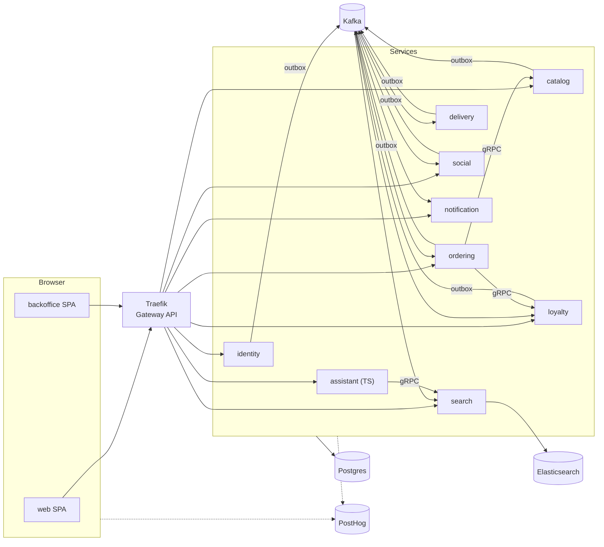

# NothingEats

> **Order everything. Eat nothing.**

NothingEats is a fake food-ordering shop with everything a real product has: accounts, mails, search, event-driven microservices, a live delivery simulation, gamification, an AI "Craving Coach", product analytics and GitOps deployment. The only thing missing is the food (and the payment).

This repo is the hub: architecture overview, links to every repo, and the tooling to run the whole system locally.

> 🚧 Work in progress. The architecture below is the plan; repos appear as they are built.

## Architecture



- **Bounded contexts as services** — Kotlin + Ktor, hexagonal Gradle modules, one repo and one pipeline each.
- **Events** — Kafka with transactional outbox and idempotent consumers.
- **Sync calls** — gRPC with producer-owned buf modules and breaking-change checks.
- **Auth** — own identity service, JWTs verified in every service via JWKS.
- **Search & RAG** — Elasticsearch hybrid search (BM25 + vectors, client-side RRF).
- **Frontend** — Vite + React SPAs with CSS Modules, built on a React Aria design system.
- **Product analytics** — PostHog end to end: events from browser and backend under one distinct id, feature flags, experiments, session replay, surveys, error tracking, LLM analytics.
- **Delivery** — GitHub Actions → signed images in GHCR → Flux on Kubernetes (k3d locally).

## Repositories

| Area | Repo | Purpose |
|---|---|---|
| Platform | [`nothingeats`](https://github.com/slashncode/nothingeats) | This hub: overview, toolchain, local cluster |
| | `nothingeats-ci` | Reusable GitHub Actions workflows, Renovate preset |
| | `nothingeats-kotlin-platform` | Shared Kotlin modules, BOM, convention plugins |
| | `nothingeats-kotlin-service-template` | Template for new Kotlin services |
| | `nothingeats-charts` | Helm charts for services and static web apps |
| | `nothingeats-gitops` | Flux configuration for all clusters |
| | `nothingeats-e2e` | Playwright system tests, k6 load tests |
| Services | `nothingeats-identity-service` | Accounts, auth, JWKS, consent, GDPR |
| | `nothingeats-catalog-service` | Restaurants, dishes, flash deals |
| | `nothingeats-search-service` | Search, autocomplete, retrieval for the AI chat |
| | `nothingeats-ordering-service` | Carts, checkout, orders |
| | `nothingeats-delivery-service` | Kitchen and courier simulation |
| | `nothingeats-loyalty-service` | XP, badges, streaks, coupons, spin the wheel |
| | `nothingeats-social-service` | Live feed, leaderboards, share cards |
| | `nothingeats-notification-service` | Mails, web push, server-sent events |
| | `nothingeats-assistant-service` | Craving Coach AI chat (TypeScript) |
| Frontend | `nothingeats-ui` | Design system product layer + Storybook |
| | `nothingeats-web` | Customer app (PWA) |
| | `nothingeats-backoffice` | Admin app |

## Run it locally

Requirements: [mise](https://mise.jdx.dev), Docker with at least 12 GB of memory, and the [GitHub CLI](https://cli.github.com) logged in.

```bash
gh repo clone slashncode/nothingeats
cd nothingeats
mise install          # pinned toolchain from mise.toml
just clone            # clones all other repos next to this one
just up               # k3d cluster + Flux bootstrap (needs GITHUB_TOKEN)
```

| URL | What |
|---|---|
| http://nothingeats.localhost | Customer app |
| http://admin.nothingeats.localhost | Backoffice |
| http://mail.nothingeats.localhost | Mailpit (all outgoing mail) |

Other recipes: `just --list`.
