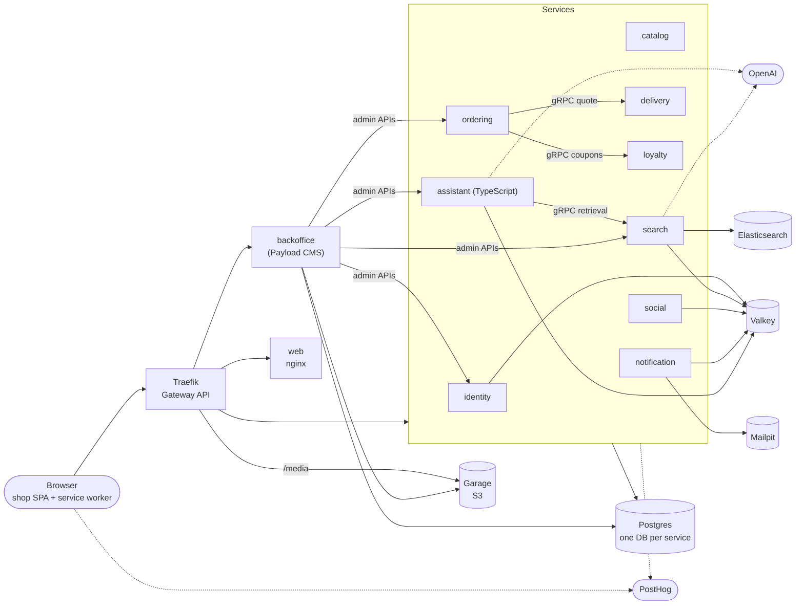

# NothingEats

> **Order everything. Eat nothing.**

NothingEats is a fake food-ordering shop with everything a real product has: accounts and mails, search, a cart and a checkout, a delivery you can watch live on a map, levels and badges, a wheel of fortune, an AI "Craving Coach", a CMS for the content, product analytics, and GitOps deployment to Kubernetes. The only thing missing is the food (and the payment: you pay with willpower).

This repo is the hub: the architecture overview, links to every repo, and the tooling to run the whole system on a laptop.

## What a customer sees

- **Browse and search** restaurants and dishes in German and English: facets for cuisine, diet, allergens, heat, mood and price, suggestions while typing ("pomm" finds Trüffelpommes), flash deals with a countdown.
- **Order nothing**: cart, coupons, checkout with a delivery quote, then a courier who rides a curved route across Hamburg on a live map until "Nichts ist angekommen. Guten Appetit!". Mails for every step, web push when the shop is closed.
- **Get rewarded** for it: XP and levels, 20 badges, daily streaks, a stamp card per restaurant, a spin of the wheel per level, an anonymous live feed and an opt-in weekly leaderboard.
- **Ask the Craving Coach** "I'm hungover and need something greasy": an AI chat that searches the catalog and answers with dish cards you can put in the cart.
- **Own their data**: consent before any analytics, a GDPR download of everything stored, and account deletion that reaches every service and PostHog.

Admins run the shop in a **backoffice** (Payload CMS): restaurants, menus, photos, deals, badges, the wheel's odds, blog articles and every text of the shop, plus views on orders, accounts, coach transcripts and the search index.

## Architecture

Nine services, each its own bounded context with its own database, repo and pipeline. They talk through Kafka events, and through gRPC where an answer is needed right away.



### Events

Every producer writes its events in the same transaction as its own change (transactional outbox) and a relay publishes them; every consumer deduplicates, retries, parks what it cannot handle in a dead-letter topic, and reports when it falls more than ten minutes behind. Topics are named `<producer>.<aggregate>.v1` and owned by the producer, with the contract in its repo's `docs/events.md`.

| Topic | Producer | Consumers |
|---|---|---|
| `backoffice.restaurant/dish/deal/deal-planner.v1` | backoffice | catalog |
| `backoffice.badge/wheel.v1` | backoffice | loyalty |
| `catalog.restaurant/dish.v1` (compacted snapshots) | catalog | search, ordering |
| `catalog.deal.v1` | catalog | ordering |
| `identity.user.v1` (registered, verified, deleted, ...) | identity | notification, ordering, delivery, loyalty, social, assistant |
| `ordering.order.v1` | ordering | delivery, loyalty, social, notification |
| `delivery.delivery.v1` | delivery | ordering, notification |
| `delivery.courier.v1` (positions, kept 1 hour) | delivery | notification |
| `loyalty.reward.v1` | loyalty | social, notification |

The backoffice is upstream of the shop: content becomes visible only when it is published, as a full snapshot through its outbox. catalog and loyalty validate what they receive and stay the only producers of their own topics.

### Building blocks

- **Kotlin services**: Ktor, kotlin-inject, Exposed + Flyway, hexagonal Gradle modules (`domain`, `application`, `adapters`, `app`). One binary with three modes: `serve`, `migrate` (a Helm hook before every rollout), and `cron <task>` (Kubernetes CronJobs). Shared code lives in [`nothingeats-kotlin-platform`](https://github.com/slashncode/nothingeats-kotlin-platform), one version for all modules.
- **TypeScript where it fits**: the Craving Coach (Vercel AI SDK, Hono, Drizzle) and the backoffice (Payload 4 on TanStack Start) follow the same contract: the same configuration names, probes, error codes and dead-letter headers.
- **Auth**: an own identity service issues RS256 access tokens (15 minutes) and rotating refresh tokens with reuse detection. Every service verifies tokens itself against identity's JWKS, gRPC included; routes are closed unless declared public.
- **Search and RAG**: Elasticsearch with German decompounding and synonyms, an index generation per mapping behind aliases (reindex without downtime), and hybrid retrieval (BM25 + kNN on OpenAI embeddings, fused with weighted reciprocal rank fusion) for the coach. Golden-query suites gate search quality in CI.
- **Live updates**: server-sent events from notification, fanned out over Valkey pub/sub; web push with VAPID for when the shop is closed.
- **Frontend**: a Vite + React SPA with TanStack Router and Query, SCSS modules and a design system on React Aria ([`nothingeats-ui`](https://github.com/slashncode/nothingeats-ui), Storybook with accessibility checks), DE/EN with ICU messages that editors can override in the backoffice.

### PostHog

PostHog is part of the architecture, not an add-on. Nothing is loaded before the visitor agrees; after that, browser and services send events under the same distinct id, so a funnel runs from `dish_add_clicked` in the browser to `order_placed` in ordering.

- **Product analytics**: a typed event taxonomy (`TRACKING_PLAN.md` in the web repo), server-side source-of-truth events through a Ktor plugin, session replay linked from server events.
- **Feature flags and experiments**: the coach is behind a flag evaluated locally (no person data sent for the decision); the wheel's odds are an experiment whose variants pick odds profiles maintained in the CMS.
- **Surveys**: "How satisfying was nothing?" after a delivery, in the language on screen.
- **LLM analytics**: every coach turn is a trace of generations and tool spans, with tokens, cost and latency.
- **Error tracking**: the Kotlin services report their exceptions, and every event consumer reports when it stops keeping up.
- **GDPR**: deleting an account also deletes the PostHog person with its events and recordings.

### Delivery and operations

- **CI**: GitHub Actions with reusable workflows ([`nothingeats-ci`](https://github.com/slashncode/nothingeats-ci)): tests with Testcontainers, `buf lint` and `buf breaking` for gRPC contracts, CodeQL, multi-arch images signed with cosign in GHCR.
- **CD**: Flux on Kubernetes ([`nothingeats-gitops`](https://github.com/slashncode/nothingeats-gitops)): Helm releases from one shared chart, image automation that commits new tags, secrets encrypted with SOPS + age.
- **System tests** ([`nothingeats-e2e`](https://github.com/slashncode/nothingeats-e2e)): every gitops change builds a whole cluster in a GitHub runner and runs Playwright through the shop and the backoffice, a k6 smoke run, and chaos tests (kill delivery mid-delivery, the Kafka broker before an order, notification while the customer watches): each order arrives exactly once. A k6 load test finds where a cluster bends.
- **Hardening**: default-deny network policies where each service names its callers; a Content-Security-Policy per kind of response (shop, CMS, APIs); rate limits and lockouts on everything that takes a password; SCRAM on the only Kafka listener outside the cluster.

## Repositories

| Area | Repo | Purpose |
|---|---|---|
| Platform | [`nothingeats`](https://github.com/slashncode/nothingeats) | This hub: overview, toolchain, local cluster |
| | [`nothingeats-ci`](https://github.com/slashncode/nothingeats-ci) | Reusable GitHub Actions workflows, Renovate preset |
| | [`nothingeats-kotlin-platform`](https://github.com/slashncode/nothingeats-kotlin-platform) | Shared Kotlin modules (lifecycle, HTTP, gRPC, persistence, Kafka, Valkey, PostHog), BOM, convention plugins |
| | [`nothingeats-kotlin-service-template`](https://github.com/slashncode/nothingeats-kotlin-service-template) | Template for new Kotlin services |
| | [`nothingeats-charts`](https://github.com/slashncode/nothingeats-charts) | Helm charts for services and static web apps |
| | [`nothingeats-gitops`](https://github.com/slashncode/nothingeats-gitops) | Flux configuration for the local and the CI cluster |
| | [`nothingeats-e2e`](https://github.com/slashncode/nothingeats-e2e) | System tests, chaos tests, k6 smoke and load tests |
| Services | [`nothingeats-identity-service`](https://github.com/slashncode/nothingeats-identity-service) | Accounts, sign-in, JWKS, consent, GDPR export and deletion |
| | [`nothingeats-catalog-service`](https://github.com/slashncode/nothingeats-catalog-service) | Restaurants, dishes, opening hours, flash deals |
| | [`nothingeats-search-service`](https://github.com/slashncode/nothingeats-search-service) | Search, suggestions, facets, embeddings and retrieval for the coach |
| | [`nothingeats-ordering-service`](https://github.com/slashncode/nothingeats-ordering-service) | Carts, coupons, checkout, orders |
| | [`nothingeats-delivery-service`](https://github.com/slashncode/nothingeats-delivery-service) | Kitchen and courier simulation, quotes |
| | [`nothingeats-loyalty-service`](https://github.com/slashncode/nothingeats-loyalty-service) | XP, badges, streaks, stamp cards, coupons, the wheel |
| | [`nothingeats-social-service`](https://github.com/slashncode/nothingeats-social-service) | Anonymous live feed, weekly leaderboard |
| | [`nothingeats-notification-service`](https://github.com/slashncode/nothingeats-notification-service) | Mails, web push, server-sent events |
| | [`nothingeats-assistant-service`](https://github.com/slashncode/nothingeats-assistant-service) | Craving Coach AI chat (TypeScript) |
| Frontend | [`nothingeats-ui`](https://github.com/slashncode/nothingeats-ui) | Design system product layer + Storybook |
| | [`nothingeats-web`](https://github.com/slashncode/nothingeats-web) | Customer app (PWA) |
| | [`nothingeats-backoffice`](https://github.com/slashncode/nothingeats-backoffice) | Headless CMS and admin views (Payload) |

## Run it locally

Requirements: [mise](https://mise.jdx.dev), Docker with at least 12 GB of memory, and the [GitHub CLI](https://cli.github.com) logged in.

```bash
gh repo clone slashncode/nothingeats
cd nothingeats
mise install          # pinned toolchain from mise.toml
just clone            # clones all other repos next to this one
just up               # k3d cluster + Flux bootstrap (needs GITHUB_TOKEN)
```

| URL | What |
|---|---|
| http://nothingeats.localhost | Customer app |
| http://nothingeats.localhost/admin | Backoffice |
| http://mail.nothingeats.localhost | Mailpit (all outgoing mail) |

Other recipes: `just --list`. `just e2e` runs the system tests against the local cluster, `just dev <service>` swaps one service for a Tilt inner loop, `just kafka-env` prints the login for Kafka from the host.

### On a phone

`just lan` serves the shop on the current Wi-Fi over HTTPS (`https://<this Mac's address>:8443`), so a phone can install it and receive web push; both need a secure context. It creates a small CA in `~/.config/nothingeats/lan` (name constrained to private addresses and this Mac's `.local` name, so it cannot vouch for anything else) and prints how to install it on an iPhone or Android phone. Anyone on the Wi-Fi reaches the shop while it runs. The cluster's own ports and its image registry are bound to `127.0.0.1` (`k3d/cluster.yaml`), so only this proxy is visible on the network.

## License

MIT
